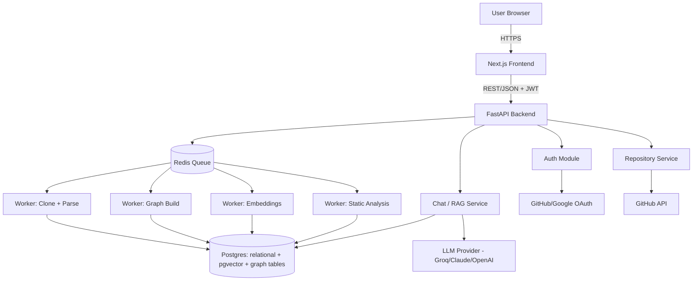
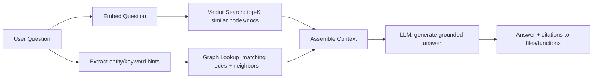
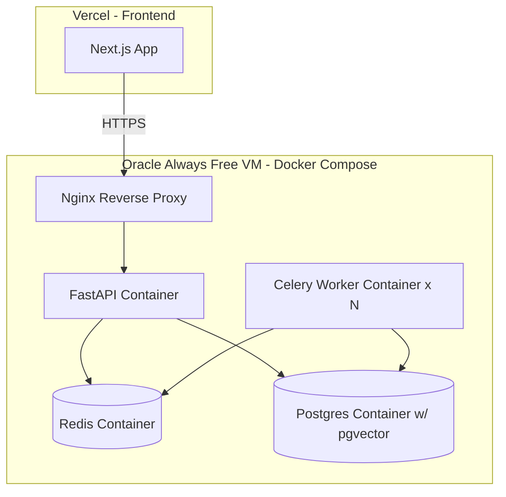

# System Architecture — High-Level Design (HLD)
## DevLens AI V1

**Document Version:** 1.0
**Companion Documents:** `02-Tech-Stack.md`, `03-SRS.md`, `05-Database-Design.md`

---

## 1. Architecture Overview

DevLens AI V1 is a **modular monolith with an asynchronous processing pipeline** — a single deployable backend service, decomposed internally into clear modules, with heavy/long-running work offloaded to background workers via a queue. This is the correct complexity level for a solo developer: it avoids premature microservices while still being cleanly separable later (each module maps 1:1 to a potential future microservice).



---

## 2. Component Breakdown

### 2.1 Frontend (Next.js)
- Server-rendered pages for landing/auth (SEO + fast first load)
- Client-rendered dashboard and repository detail views (interactive: chat, diagrams)
- Talks to backend only via REST endpoints defined in `06-API-Specification.md`
- Renders architecture/trace diagrams using Mermaid.js from graph data returned by the API (backend sends graph JSON; frontend converts to Mermaid syntax or uses a dedicated graph-rendering library like `react-flow` for interactivity)

### 2.2 API Layer (FastAPI)
Responsibilities:
- Request validation, auth (JWT verification), rate limiting
- Synchronous endpoints: auth, repository CRUD, dashboard reads, chat message send/receive
- Enqueues long-running jobs (import/index) to the queue and returns immediately with a job ID; frontend polls a status endpoint

### 2.3 Repository Processing Engine (Celery Workers)
Broken into **discrete, independently retryable stages**, each a separate Celery task chained together:

1. **Clone Stage** — shallow clone (`--depth 1`) into an isolated temp workspace; enforce size limit before/during clone.
2. **Language Detection Stage** — file-extension + heuristic scan (e.g., using `linguist`-style rules or a simple extension-frequency count) to determine primary language(s).
3. **Parse Stage** — walk the file tree, skip ignored directories, run Tree-sitter parsers per supported language, extract entities (functions, classes, imports) with file/line metadata.
4. **Graph Build Stage** — resolve relationships between extracted entities (import resolution, call resolution within statically analyzable scope) and write nodes/edges to the graph store.
5. **Embedding Stage** — for each entity and doc chunk, build a text representation (signature + docstring + surrounding context) and compute embeddings; write to pgvector.
6. **Static Analysis Stage** — run language-appropriate linters/security scanners as subprocesses in a sandboxed container; parse their output into a normalized internal format.
7. **Report Generation Stage** — aggregate static analysis + graph metrics (e.g., fan-in/fan-out, cyclomatic complexity) into the Health Score (see Section 6).

Each stage updates a `job_status` record so the frontend can show granular progress (FR-2.6).

### 2.4 AI Orchestrator / RAG Service
For V1, this is a **single retrieval-then-generate pipeline**, not the full multi-agent system described in the original concept (that arrives in V2+, see roadmap). The pipeline:



This single pipeline directly implements FR-6.2/FR-6.3, and is also reused (with a different prompt template) for **Feature Tracing** (FR-7.x): instead of a single answer, the LLM is asked to order the retrieved nodes into a path and the graph traversal does shortest-path/BFS between the identified entry node and likely terminal nodes (e.g., a database access function).

### 2.5 LLM Provider Abstraction
A single Python interface (`LLMProvider`) with methods `generate(prompt, context) -> str` and `embed(text) -> vector`. Concrete implementations: `GroqProvider`, `ClaudeProvider`, `OpenAIProvider`, `LocalOllamaProvider`. Selected via environment configuration — satisfies NFR-9.

### 2.6 Data Layer
See `05-Database-Design.md` for full schema. Summary of stores:
- **Postgres (relational):** users, repositories, files, jobs, static analysis results, health reports, chat history
- **Postgres + pgvector (vector):** embeddings table with a `vector` column
- **Postgres (graph-as-tables) in V1 → Neo4j in V2:** `graph_nodes`, `graph_edges` tables with recursive CTE support for traversal

---

## 3. Deployment View



Single VM hosts the entire backend stack via Docker Compose for V1 — the simplest possible deployment that still satisfies NFR-1 (15-minute processing budget) because Oracle's Always Free ARM tier provides real, dedicated CPU/RAM rather than a shared/throttled serverless function.

---

## 4. Security Architecture

- **Sandboxed cloning/parsing:** cloned repository code is never executed. Parsing is static (Tree-sitter AST traversal only). Static analysis tools run in a restricted container with no network egress, satisfying NFR-5.
- **Auth:** OAuth-only in V1 (no password storage). JWT session tokens, short-lived access token + refresh pattern.
- **Secrets:** stored via environment variables injected at container runtime; never in the repository or frontend bundle.
- **Data isolation:** each repository's derived data (graph, embeddings, reports) is scoped by `repository_id` + `owner_user_id`; all queries filter by ownership.

---

## 5. Scalability Notes (Path Beyond MVP)

| Bottleneck at scale | V1 approach | Future mitigation |
|---|---|---|
| CPU-bound parsing of large repos | Single VM, sequential-per-repo workers | Horizontal worker scaling across multiple VMs behind the same Redis queue |
| Graph traversal performance | Recursive CTEs in Postgres | Migrate to Neo4j Community for native graph traversal performance |
| LLM cost/rate limits | Free-tier Groq, single request per question | Response caching for repeated questions; provider fallback chain |
| Concurrent repository processing | Queue naturally serializes/parallelizes via worker count | Increase worker concurrency; add priority queues |

---

## 6. Health Score Formula (Transparent, Documented per FR-9.3)

```
HealthScore = 100
  - (ComplexityPenalty)
  - (SecurityPenalty)
  - (DuplicationPenalty)
  - (DependencyStalenessPenalty)

ComplexityPenalty        = min(25, avg_cyclomatic_complexity_over_threshold * weight_c)
SecurityPenalty          = min(30, (critical_findings * 6 + high_findings * 3 + medium_findings * 1))
DuplicationPenalty       = min(20, duplicate_code_percentage * weight_d)
DependencyStalenessPenalty = min(15, outdated_major_versions_count * weight_s)

Score is floored at 0, ceilinged at 100.
```

Weights (`weight_c`, `weight_d`, `weight_s`) are configuration constants, documented in code, and adjustable — this avoids the "black box AI score" problem and makes the report defensible and explainable to users (a deliberate differentiator vs. tools that produce an opaque score).
