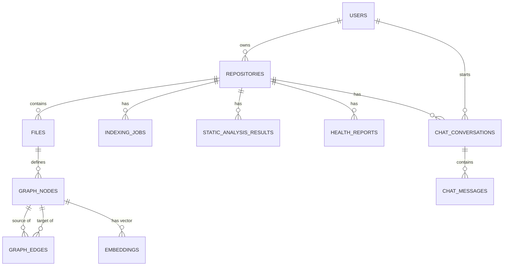

# Database Design Document
## DevLens AI V1

**Document Version:** 1.0
**Engine:** PostgreSQL 15+ with `pgvector` extension
**Companion Documents:** `04-System-Architecture-HLD.md`, `03-SRS.md`

---

## 1. Entity-Relationship Overview



---

## 2. Table Definitions

### 2.1 `users`
| Column | Type | Notes |
|---|---|---|
| id | UUID PK | |
| github_id | TEXT UNIQUE | nullable if signed up via Google |
| google_id | TEXT UNIQUE | nullable |
| username | TEXT | |
| email | TEXT | nullable (GitHub may not expose it) |
| avatar_url | TEXT | |
| created_at | TIMESTAMPTZ | default now() |
| last_login_at | TIMESTAMPTZ | |

### 2.2 `repositories`
| Column | Type | Notes |
|---|---|---|
| id | UUID PK | |
| owner_user_id | UUID FK → users.id | |
| name | TEXT | e.g. "devlens-ai" |
| full_name | TEXT | e.g. "octocat/devlens-ai" |
| source_url | TEXT | GitHub URL |
| default_branch | TEXT | |
| size_kb | INTEGER | from GitHub API |
| primary_language | TEXT | detected |
| languages | JSONB | e.g. {"Python": 70, "JavaScript": 30} |
| status | TEXT | enum: `pending`, `indexing`, `ready`, `failed` |
| health_score | INTEGER | cached latest score, nullable until first report |
| last_indexed_at | TIMESTAMPTZ | nullable |
| created_at | TIMESTAMPTZ | default now() |

### 2.3 `indexing_jobs`
| Column | Type | Notes |
|---|---|---|
| id | UUID PK | |
| repository_id | UUID FK | |
| stage | TEXT | enum: `cloning`, `detecting_language`, `parsing`, `building_graph`, `embedding`, `static_analysis`, `report_generation`, `done`, `failed` |
| progress_pct | INTEGER | 0–100 |
| error_message | TEXT | nullable |
| started_at | TIMESTAMPTZ | |
| completed_at | TIMESTAMPTZ | nullable |

### 2.4 `files`
| Column | Type | Notes |
|---|---|---|
| id | UUID PK | |
| repository_id | UUID FK | |
| path | TEXT | relative path within repo |
| language | TEXT | |
| loc | INTEGER | lines of code |
| sha | TEXT | git blob sha, for change detection on re-index |

### 2.5 `graph_nodes`
| Column | Type | Notes |
|---|---|---|
| id | UUID PK | |
| repository_id | UUID FK | (denormalized for query speed/scoping) |
| file_id | UUID FK → files.id | nullable for repo-level/synthetic nodes |
| node_type | TEXT | enum: `file`, `class`, `function`, `method`, `module`, `route` |
| name | TEXT | e.g. "AuthService.login" |
| qualified_name | TEXT | fully qualified path-like identifier, unique per repo |
| start_line | INTEGER | |
| end_line | INTEGER | |
| signature | TEXT | e.g. "def login(self, username: str, password: str) -> Token" |
| docstring | TEXT | nullable |

**Index:** `(repository_id, qualified_name)` unique; `(repository_id, node_type)` for filtered queries.

### 2.6 `graph_edges`
| Column | Type | Notes |
|---|---|---|
| id | UUID PK | |
| repository_id | UUID FK | (denormalized) |
| source_node_id | UUID FK → graph_nodes.id | |
| target_node_id | UUID FK → graph_nodes.id | |
| edge_type | TEXT | enum: `calls`, `imports`, `extends`, `implements`, `defines`, `depends_on` |
| confidence | REAL | 1.0 for statically resolved, lower for heuristic matches |

**Index:** `(repository_id, source_node_id)`, `(repository_id, target_node_id)` — both needed for bidirectional traversal.

**Recursive traversal example (V1 graph-as-tables approach):**
```sql
WITH RECURSIVE trace AS (
    SELECT source_node_id, target_node_id, edge_type, 1 AS depth
    FROM graph_edges
    WHERE source_node_id = :start_node_id
      AND repository_id = :repo_id
    UNION ALL
    SELECT ge.source_node_id, ge.target_node_id, ge.edge_type, t.depth + 1
    FROM graph_edges ge
    JOIN trace t ON ge.source_node_id = t.target_node_id
    WHERE t.depth < 6 AND ge.repository_id = :repo_id
)
SELECT * FROM trace;
```

### 2.7 `embeddings`
| Column | Type | Notes |
|---|---|---|
| id | UUID PK | |
| repository_id | UUID FK | |
| node_id | UUID FK → graph_nodes.id | nullable if this embedding is a doc chunk, not a code node |
| source_type | TEXT | enum: `code`, `documentation` |
| content_excerpt | TEXT | text that was embedded (for citation display) |
| vector | VECTOR(384) | dimension matches chosen embedding model (e.g., MiniLM = 384) |

**Index:** `ivfflat` or `hnsw` index on `vector` column via pgvector for approximate nearest-neighbor search.

### 2.8 `static_analysis_results`
| Column | Type | Notes |
|---|---|---|
| id | UUID PK | |
| repository_id | UUID FK | |
| tool | TEXT | e.g. "ruff", "bandit", "eslint" |
| file_id | UUID FK | nullable |
| line | INTEGER | nullable |
| severity | TEXT | enum: `critical`, `high`, `medium`, `low`, `info` |
| rule_id | TEXT | tool-specific rule identifier |
| message | TEXT | |
| created_at | TIMESTAMPTZ | |

### 2.9 `health_reports`
| Column | Type | Notes |
|---|---|---|
| id | UUID PK | |
| repository_id | UUID FK | |
| overall_score | INTEGER | 0–100 |
| complexity_score | INTEGER | |
| security_score | INTEGER | |
| duplication_score | INTEGER | |
| dependency_score | INTEGER | |
| generated_at | TIMESTAMPTZ | |
| metrics_json | JSONB | raw computed metrics for transparency/debugging |

### 2.10 `chat_conversations`
| Column | Type | Notes |
|---|---|---|
| id | UUID PK | |
| repository_id | UUID FK | |
| user_id | UUID FK | |
| title | TEXT | auto-generated from first question |
| created_at | TIMESTAMPTZ | |

### 2.11 `chat_messages`
| Column | Type | Notes |
|---|---|---|
| id | UUID PK | |
| conversation_id | UUID FK | |
| role | TEXT | enum: `user`, `assistant` |
| content | TEXT | |
| citations_json | JSONB | list of `{node_id, file_path, line_range}` referenced in the answer |
| created_at | TIMESTAMPTZ | |

---

## 3. Design Notes

1. **Denormalized `repository_id` on graph/embedding tables** — deliberate trade-off to avoid an extra join on every scoped query (every query in the system is scoped to one repository), at the cost of slightly more write-time bookkeeping.
2. **`confidence` field on edges** — since not all relationships are staticaly resolvable with certainty (e.g., dynamic dispatch, reflection), edges carry a confidence score so the UI and AI layer can express uncertainty rather than presenting heuristic guesses as fact.
3. **JSONB `metrics_json` on health_reports** — keeps the door open to add new metrics without a schema migration, while the named columns keep common queries fast and typed.
4. **No hard delete cascade without explicit user action** — `repositories` deletion cascades to all derived tables only when the user explicitly requests deletion (NFR-13), implemented at the application layer with a confirmation step, not as an automatic DB trigger, to avoid accidental data loss.
